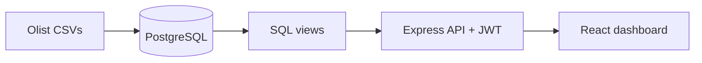

# Olist E-Commerce Analytics Platform

A full-stack analytics web app on the Olist Brazilian e-commerce dataset (99,441 orders, 2016 to 2018).
It answers one business question: **how much do late deliveries hurt customer satisfaction?**


## Key findings
- **96,478** delivered orders generated **R$ 13.2M** in revenue, with an average order value of **R$ 137.04**.
- **8.11%** of delivered orders arrived after the estimated date.
- Delivery delay strongly lowers review scores:

| Delivery | Orders | Avg review |
|---|---|---|
| On time or early | 88,163 | 4.29 |
| Up to 3 days late | 2,636 | 3.77 |
| 3 to 7 days late | 1,773 | 2.32 |
| Over 7 days late | 3,252 | 1.73 |

- Orders more than 7 days late average about **2.5 stars less** than on-time orders.
- Of the sellers with 30+ delivered orders, 150 are green, 409 amber and 68 red on the scorecard.
- [Add one finding from your Sales page, for example the top category or the top state.]

**Recommendation:** [one sentence, for example: "Prioritise carrier and seller fixes for orders at risk of passing 3 days late, because review scores fall sharply beyond that point."]

## Features
- Public landing page with an interactive delay explorer
- Role-based login (JWT) with **admin** and **viewer** roles
- Overview dashboard: orders, revenue, average order value, late rate, monthly revenue trend
- Sales: top categories and states by revenue
- Delivery: review score by delay bucket (the delay-impact analysis)
- Seller scorecard: green, amber and red grading with filters
- Admin-only "Add order" form with server-side validation and a database transaction

## Tech stack
PostgreSQL, Node.js, Express, React (Vite), Recharts, JWT, bcrypt

## Architecture


## SQL highlights
- Joins, CTEs, `FILTER` aggregates and `DATE_TRUNC` in `sql/`
- Reviews are averaged per order before joining, so orders with two reviews are not counted twice
- SQL views feed the API, so the business logic lives in the database
- Seller scorecard grades only sellers with 30+ delivered orders, to avoid judging tiny samples

## Data quality notes
- [X] delivered orders have no delivery date and are excluded from delay metrics
- [X] orders have more than one review
- [X] products have no category
- Very few orders exist in late 2016, so the start of the revenue chart is low

Metric definitions and scorecard thresholds are in `DECISIONS.md`.

## Screenshots
| Overview | Sales |
|---|---|
|  |  |

| Delivery | Sellers |
|---|---|
|  |  |

| Sign in | Add order (admin) |
|---|---|
|  |  |

## Run it locally
1. Install Node 20+ and PostgreSQL 15+.
2. Download the Olist dataset from Kaggle into `data/raw/`.
3. Create the database and load it:
```
   createdb -U postgres olist
   psql -U postgres -d olist -f db/schema.sql
   psql -U postgres -d olist -f db/load.sql
   psql -U postgres -d olist -f sql/02_views.sql
   psql -U postgres -d olist -f sql/03_users.sql
   psql -U postgres -d olist -f sql/04_views_sales_delivery.sql
   psql -U postgres -d olist -f sql/05_seller_scorecard.sql
```
4. Copy `server/.env.example` to `server/.env` and fill it in.
5. Start the API: `cd server && npm install && node seed-users.js && node index.js`
6. Start the website: `cd client && npm install && npm run dev`
7. Open http://localhost:5173. After signing in you land on `/app`.

**Demo logins:** `admin@olist.dev` / `Admin@123` and `viewer@olist.dev` / `Viewer@123`

## Limitations and next steps
- Demo accounts only. A real deployment would need strong passwords and rate limiting.
- Scorecard thresholds (15% late, 3.5 stars) are my own choices, based on the 8.11% overall late rate.
- Orders added through the form use zip prefix `00000` so they can be found and removed.
- Next: cohort retention page, delay-risk prediction, automated tests.